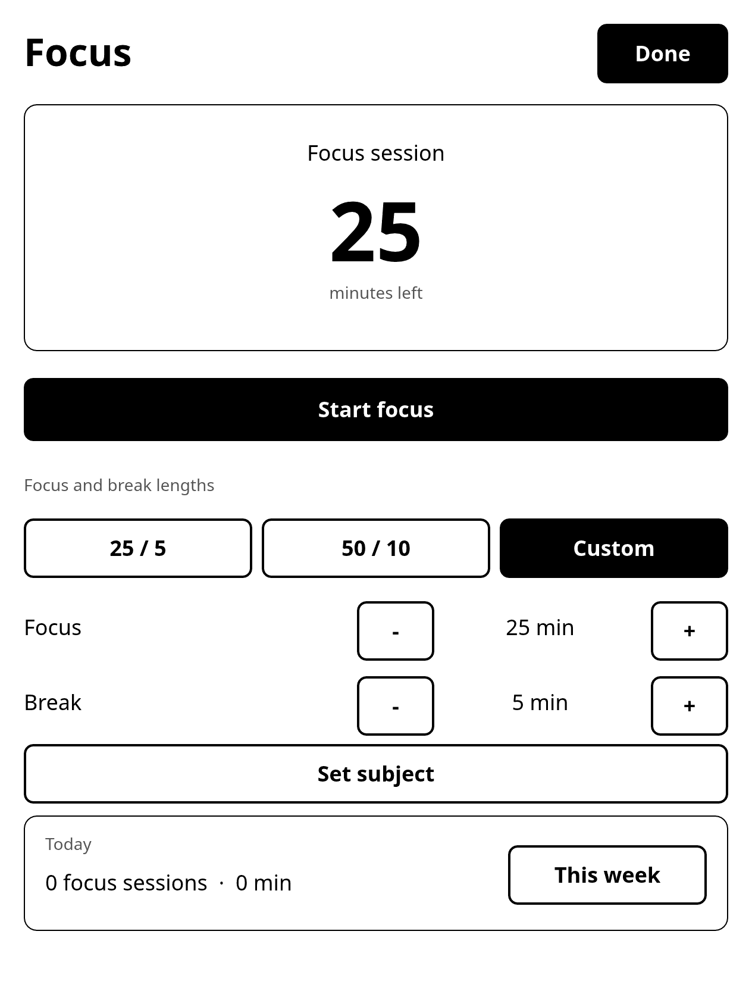
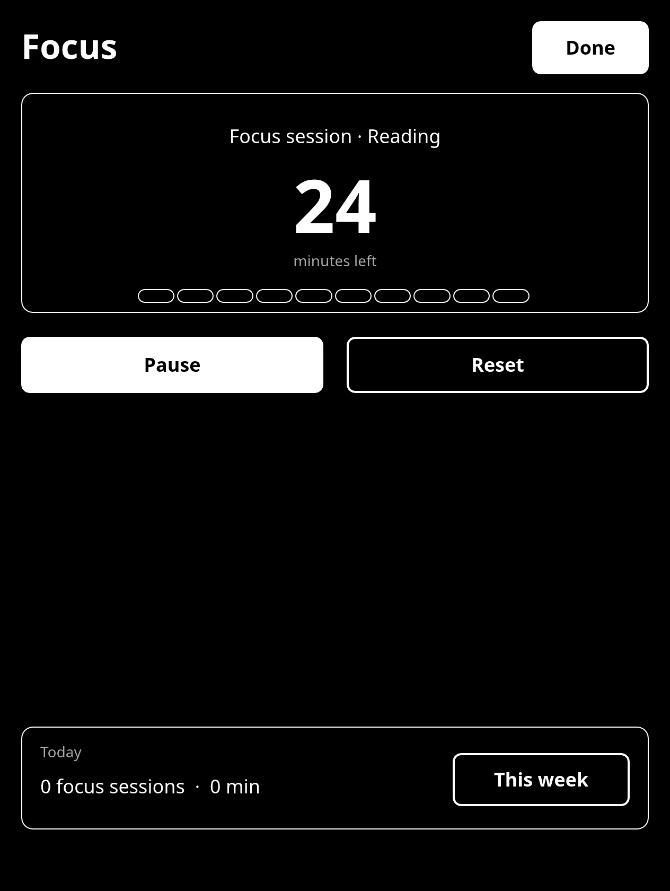
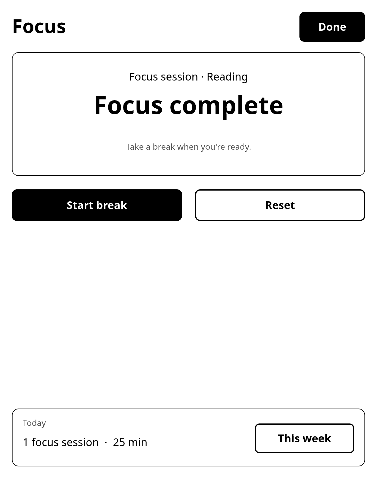
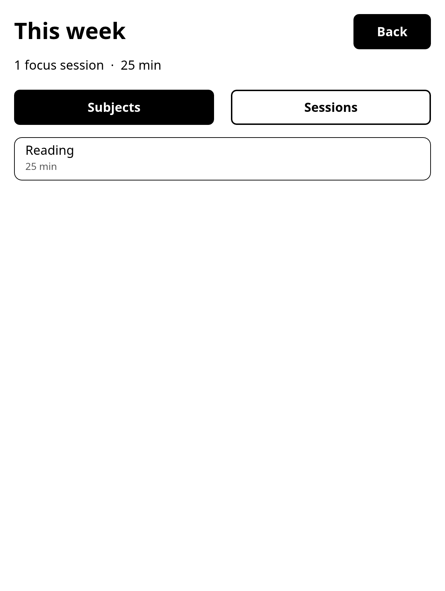
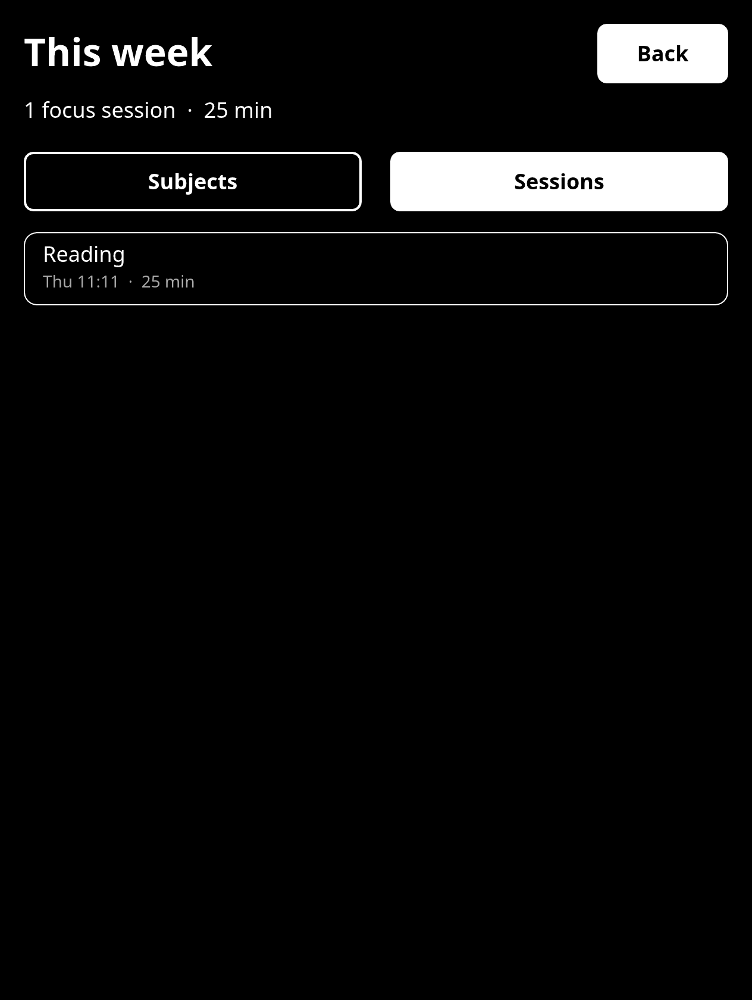

<div align="center">

# Focus

**Focus timers and a study log**

[](https://github.com/PrimitiveOS/kindle-primitive-focus/releases) [](LICENSE) [](https://primitiveos.github.io/kindle-primitive-catalog/v1/index.json)

[**Download**](https://github.com/PrimitiveOS/kindle-primitive-focus/releases/latest) · [**Install guide**](INSTALL.md) · [**Changelog**](CHANGELOG.md)

</div>

---

Choose a 25/5 or 50/10 focus and break preset or set your own timer. Label sessions by subject, then see weekly time and recent sessions in the study log.

## Quick start

After setting up PrimitiveOS, open **Store** from Primitive Launcher. Choose **Focus** under **Apps**,
tap **Get**, and open it from the Launcher grid. The [install guide](INSTALL.md) also covers the standalone USB package.

## Screenshots

<table>
  <tr>
    <td align="center"><br><sub>Presets and custom lengths</sub></td>
    <td align="center"><br><sub>A running timer in dark mode</sub></td>
    <td align="center"><br><sub>Session complete</sub></td>
  </tr>
  <tr>
    <td align="center"></td>
    <td align="center"></td>
  </tr>
</table>

<sub>Desktop simulation at 1264 × 1680 with sample timers.</sub>

## Highlights

- Use the 25/5 or 50/10 minute presets, or set separate focus and break lengths.
- Start, pause, and reset the timer. Choose **Set subject** before starting focus and reuse recent subject labels.
- Open **This week** for Monday-to-Sunday totals by subject or a list of completed sessions. Breaks stay out of the study log.
- Session state is saved on sleep and exit. The Kindle driver refreshes the idle timer during a running session.

## Develop locally

Keep `doannt-kindle-tools` and `doannt-kindle-launcher` next to this checkout. The desktop command writes sample PNGs
to `build/previews`. The local `app.json` contains draft listing copy.

```sh
cargo test --offline --locked --workspace
cargo run --offline --locked -p focus-desktop -- build/previews
```

## Status

| Device | Status |
|---|---|
| Kindle Oasis 3 (1264 × 1680, firmware 5.18.2) | Tested on hardware |

**Current version: 0.1.2.** Changes are in [CHANGELOG.md](CHANGELOG.md).

## Downloads

**51 downloads** from Store, as of 2026-11-21. Store shows the same count on the app page.
The count is GitHub downloads of this app's release packages, from the [Store catalog](https://primitiveos.github.io/kindle-primitive-catalog/v1/index.json).

## Documentation

[Install guide](INSTALL.md) · [Changelog](CHANGELOG.md) · [Device notes](docs/device-notes.md)

## Licence

Copyright (C) 2026 Doan Nguyen.

App code is licensed under PolyForm Noncommercial 1.0.0. [Code license](LICENSE)

Original documentation and screenshots are licensed under Creative Commons Attribution-NonCommercial-ShareAlike 4.0
International (CC BY-NC-SA 4.0). [Documentation and image license](LICENSE-DOCS)
